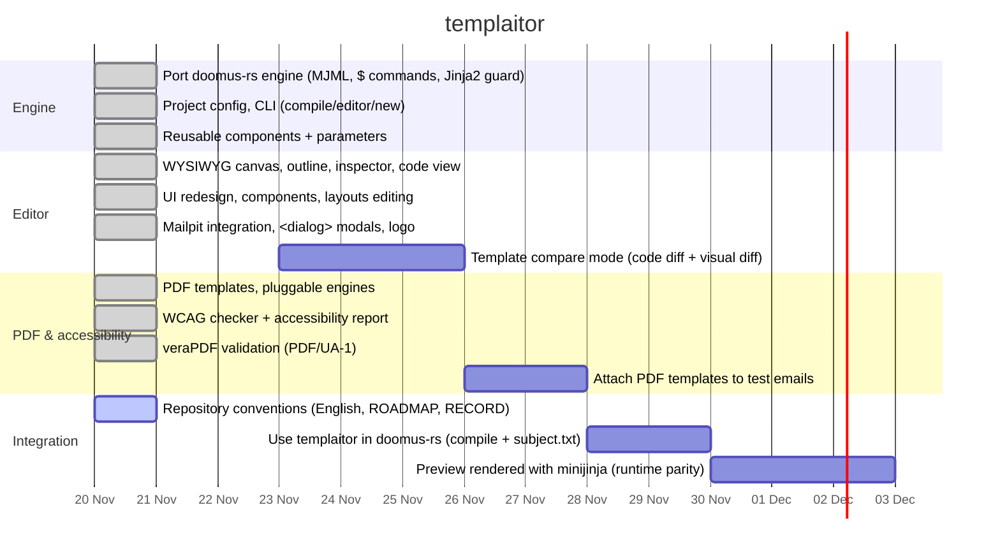

# Project plan — 2026-11-20

Goal: a generic template editor (originally the email engine of `doomus-rs`) that compiles MJML
templates to Jinja2 HTML/text, with a WYSIWYG editor, reusable components, PDF documents and
accessibility (WCAG 2.1 AA / EN 301 549 / PDF/UA-1) as a hard requirement.

## Upcoming work

1. **Template compare mode** — code diff (MJML/YAML/data) and visual diff (side by side / overlay)
   between two templates or two versions.
2. **PDF attachments** — attach a PDF template to a test email.
3. **doomus-rs integration** — replace `emails/_engine` with `templaitor compile` and read
   `*.subject.txt` in the backend.
4. **Runtime parity** — render the preview with minijinja (the runtime engine) instead of nunjucks.
