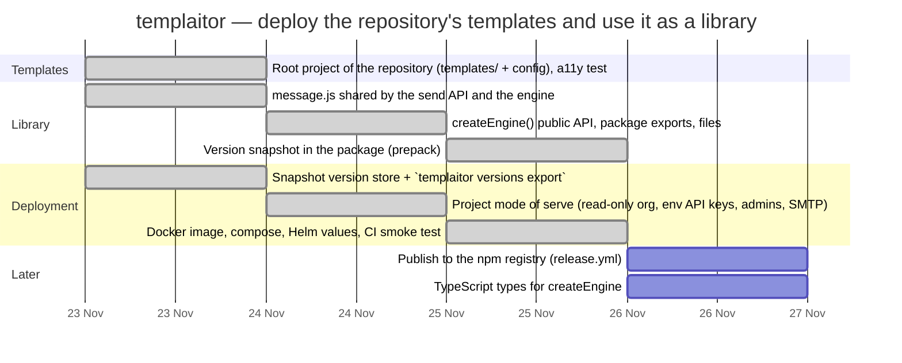

# Deploying this repository's templates, and templaitor as a library — 2026-11-23

Request: "this repository will deploy the templates it includes; it must also be usable as a dependency of
another project that uses it as its engine". The two questions asked (what the deployment does with the
templates; whether the package ships them) got no answer, so the recommended options were taken.

## Decisions

| Topic | Decision | Why |
|---|---|---|
| Which templates | The repository root is a templaitor project (`templaitor.config.yml` + `templates/`, seeded from the demo) | One place for "the templates this repository deploys"; `examples/demo` stays as the starter of new organizations |
| Deployment | **Project mode** of `templaitor serve` (`TEMPLAITOR_PROJECT`): one project, read-only, as the org `project`; API keys, admins and SMTP from the environment; sign-up by invitation; no other orgs | The repository is the source of truth: a deploy replaces the templates; editing in production would be lost |
| Versions in the image | `templaitor versions export` → `.templaitor/versions.json`, read by a read-only **snapshot** store when there is no `.git` (CI, `make docker`, npm `prepack`) | The image and the package have no repository, but `/v1/send { version }` and `engine.render(…, { version })` must keep working |
| Library | `import { createEngine } from 'templaitor'`: `templates · render · attachments · pdf · compile · build · versions`, in-process; default project = the bundled templates, `cwd` for one's own | The consumer embeds the engine instead of calling a server |
| Shared code | `src/engine/message.js` renders a template for one recipient (language, version, data, attachments) for both the send API and the library | One behaviour, one set of errors |
| Installed package | Always reads its snapshot, even inside a consumer's git repository | That repository is the consumer's, not the one where the versions were made |

