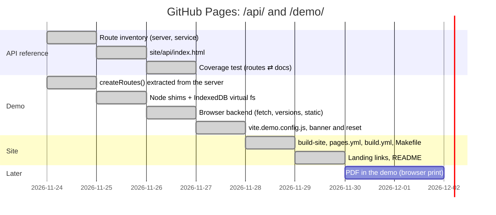

# GitHub Pages: API reference and in-browser editor demo

Request: add to GitHub Pages `/api/` (documentation of every endpoint) and `/demo/` (the editor with its
backend running in the browser, e.g. IndexedDB).

## Decisions

- **`/api/`** is a hand-written static page (`site/api/index.html`), styled like the landing page. A test
  extracts every route from the code (editor route table, binary routes, `/preview`, `/static`, the hosted
  service's route list) and fails when one is missing from the page or the page lists one that no longer
  exists, so the reference cannot drift silently.
- **`/demo/`** runs the *real* engine, not a mock: the editor and `src/engine` are bundled with Vite
  (`vite.demo.config.js`) with Node built-ins replaced by shims — an in-memory `fs` persisted to IndexedDB,
  `path-browserify`, stubs for `child_process`/`os`/`module`/`url`/`http` — plus `mjml-browser` (same
  version as `mjml`) and nunjucks' browser build. `fetch('/api/…')` is intercepted and answered by the same
  route table as the server (`createRoutes`, extracted from `createHandler`).
- Versions in the demo: a store with the same interface as the git/db ones, kept in the virtual fs. Every
  document starts with a v1 so versions and compare work at once.
- What needs programs or the network answers `501` with an explanation: PDF rendering and veraPDF, sending
  email, remote attachments. Static images become `data:` URLs (the canvas iframe is sandboxed and Pages has
  no `/static/`); the shareable preview is `?preview=<id>` on the demo page.

