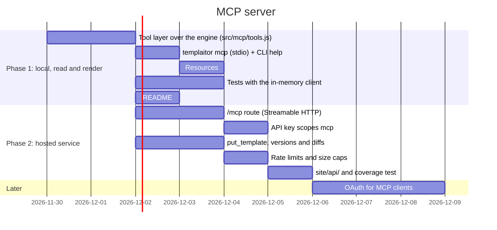

# MCP server: templates for AI assistants

Request: give templaitor an MCP (Model Context Protocol) server, so an AI assistant can
list, read, write, render and check templates without knowing the code.

## Why, and where it pays off

- **Local (`templaitor mcp`, stdio)**: an agent with a shell can already run the CLI
  (`compile`, `pdf --validate`, `validate`, `types`). The MCP server adds structured
  answers (accessibility problems as a list with their rule and place, the data contract
  as JSON Schema) and works in clients without a shell (e.g. Claude Desktop).
- **Hosted service (remote, Streamable HTTP)**: the bigger gain. A user's assistant can
  work on their workspace ("a welcome email in English and Spanish that passes the
  checker") without cloning anything nor installing the CLI.

## Tools

| Tool | What it does | Built on |
|---|---|---|
| `list_templates` | templates, locales, format (email / PDF), data contract summary | `engine/project.js`, `engine/types.js` |
| `get_template` | the sources (`mjml`, `yml`, `data`) of a template, at a version | `engine/message.js` `templateSource` |
| `template_schema` | the data contract as JSON Schema | `engine/message.js` `templateSchema` |
| `render` | subject, HTML and text for a locale and data (contract checked) | `engine/message.js` `renderMessage` |
| `check_accessibility` | WCAG 2.1 AA / EN 301 549 problems, structured | `engine/a11y.js` `accessibilityReport` |
| `render_pdf` | a PDF (as a resource) and its PDF/UA-1 report (veraPDF) | `engine/message.js` `renderPdfDocument`, `engine/verapdf.js` |
| `put_template` | write the sources; always a **new version**, never an overwrite | `engine/history.js`, `service/versions.js` |
| `list_versions` / `diff_versions` | history of a template, and what changed | `engine/versions.js` |

Resources: each template's sources (`templaitor://templates/<id>/<file>`) and the docs on
the frontmatter and the data contract, so the assistant writes valid templates.

Left out on purpose: **sending email** (`service/sender.js`). A mistake can't be undone;
if it is ever added, only to the user's own address, behind an explicit confirmation.

## Decisions

- The official SDK (`@modelcontextprotocol/sdk`), as an optional dependency loaded only by
  `templaitor mcp` and the service's `/mcp` route: the npm library (`createEngine`) stays
  as it is.
- Phase 1 is read and render only; writing comes with the hosted version, where versions
  make every change reversible.
- Remote auth: the organisation API keys the service already has (`tpl_<org>_…`, Bearer),
  with a new scope (`mcp:read`, `mcp:write`) so a key for sending can't edit templates.
  OAuth for MCP clients that need it comes after.
- Limits: PDF rendering is expensive, so a per-key rate limit and a timeout (the service's
  `rateLimiter`); render inputs size-capped like the send API.
- Tests: `node --test` with the SDK's in-memory client against the demo templates; every
  tool's output checked, and `put_template` + `check_accessibility` round trip. The
  repository's templates must keep passing the checker through the MCP path too.
- Docs: the tools listed on `site/api/` (the route coverage test learns `/mcp`), and a
  README section with the client configuration (Claude Desktop / Claude Code).

## Risks

- Prompt injection through template content: tool outputs are data; `put_template` never
  runs code, and rendering already runs in the guarded engine (`engine/guard.js`).
- SDK churn (the protocol is young): pin the version, keep the tool layer thin over the
  engine so a transport change touches one file.

